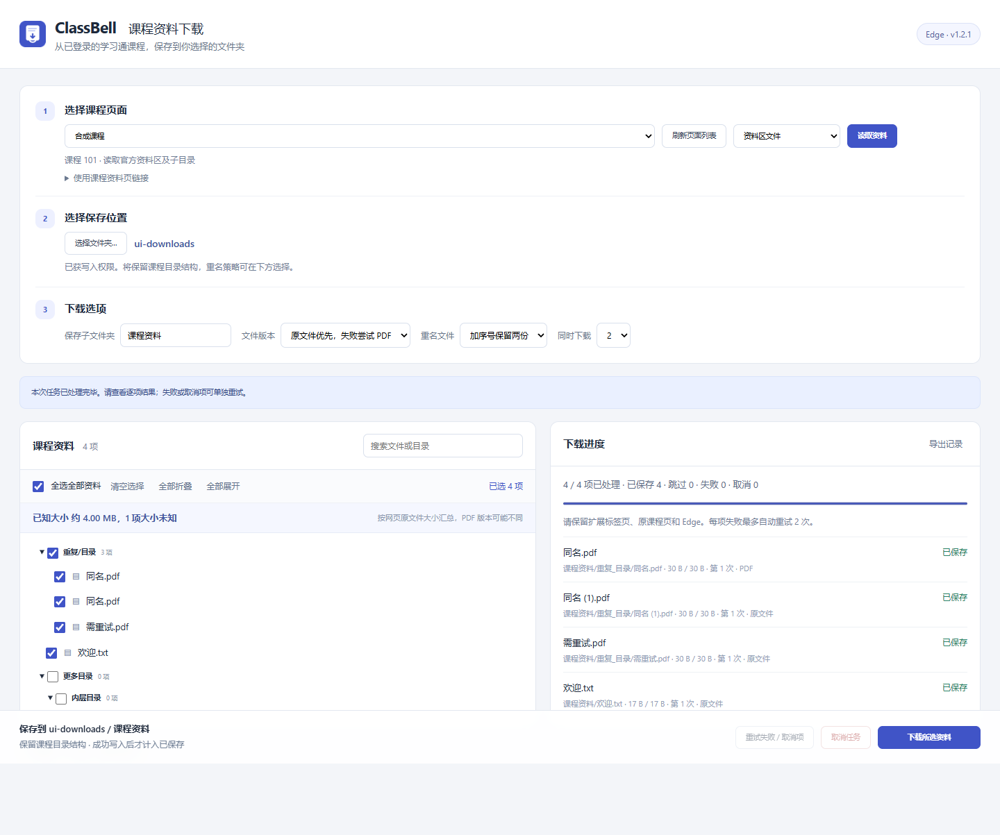

<p align="center">
  
</p>

# classbell 超星学习通资料批量下载edge插件

**选一个文件夹下载，也能全选整门课程的资料，保存到自己指定的电脑文件夹。**

适用于电脑上的 **Microsoft Edge 浏览器 + 学习通网页版**。

## 能做什么？

| 想做的事 | ClassBell 怎么帮你 |
| --- | --- |
| 下载某个文件夹 | 勾选文件夹，里面的文件和子文件夹一起选中，下载后保留目录结构。 |
| 下载全部资料 | 点击“全选全部资料”，批量保存当前课程资料区扫描到的所有文件。 |
| 保存部分限制下载的文件 | 对于网页限制直接下载、但账号能预览且接口提供文件地址的资料，可尝试保存原文件或 PDF。 |
| 自己决定存在哪里 | 弹出系统文件夹选择器，选一个实际保存位置，并记住上次选择。 |
| 下载前看看有多大 | 勾选后显示文件数量和总大小，未知大小单独提示。 |
| 文件多、目录乱 | 支持搜索、全部折叠、全部展开；重名自动加序号，失败可重试，也能取消任务。 |

## 界面长这样



*上图使用示例课程。左侧勾选要下载的资料，上方选择电脑保存位置，右侧查看结果。*

## 第一次安装：照着做就行

### 第 1 步：下载插件

**[点这里下载 ClassBell v1.1.0 插件 ZIP](https://github.com/5326AAAA/classbell-chaoxing-downloader-edge/raw/refs/heads/main/downloads/ClassBell-Edge-v1.1.0.zip)**

下载完成后，在文件上点击鼠标右键，选择 **“全部解压缩”**。

解压后，你会看到这样的文件夹：

```text
ClassBell-Edge
├─ extension        ← 安装时选择这个文件夹
│  ├─ manifest.json
│  ├─ manager.html
│  └─ ……
├─ assets
└─ README.md
```

把这个文件夹放在准备长期保留的位置，例如“文档”里的“ClassBell-Edge”。安装后请保留它，移动或删除会使扩展失效。

### 第 2 步：打开 Edge 扩展管理页

在 Edge 顶部地址栏输入下面这行，按回车：

```text
edge://extensions/
```

### 第 3 步：开启开发人员模式

找到页面左下角的 **“开发人员模式”**，打开开关。

### 第 4 步：加载插件

1. 点击 **“加载解压缩的扩展”**。
2. 打开刚才解压出来的 `ClassBell-Edge` 文件夹。
3. 选中里面的 **`extension` 文件夹**，点击 **“选择文件夹”**。

页面出现 **“ClassBell 课程资料下载”**，就装好了。选中的 `extension` 文件夹里面应当能直接找到 `manifest.json`。

### 第 5 步：打开 ClassBell

点击 Edge 右上角的 **拼图图标“扩展”**，再点击 **“ClassBell 课程资料下载”**。

想下次更方便打开，可以把它固定到工具栏。

## 开始使用：先读资料，再选位置

### 1. 在学习通打开课程

在同一个 Edge 浏览器窗口中登录学习通，进入要下载的课程，点击左侧 **“资料”**，等文件列表出现。

### 2. 让插件读取资料

1. 打开 ClassBell。
2. 在“选择课程页面”中选中刚才那门课。
3. 点击 **“读取资料”**。

如果没有看到刚打开的课程，先点击 **“刷新页面列表”**。

也可以展开 **“使用课程资料页链接”**，粘贴课程资料页的完整链接，点击 **“读取链接”**。输入错了，点旁边的 **“清空”** 即可。

### 3. 选一个电脑上的保存位置

点击 **“选择文件夹…”**，在弹出的系统窗口中选中保存位置，再允许浏览器写入文件。

例如，你选择电脑里的“学习资料”，把“保存子文件夹”填写为“概率论”，资料就会保存到：

```text
学习资料
└─ 概率论
   ├─ 第一章
   │  ├─ 讲义.pdf
   │  └─ 课件.pptx
   └─ 第二章
      └─ 复习资料.docx
```

下次打开会记住这个位置。如果出现 **“重新授权上次文件夹”**，点击并允许即可。

## 我只想下载一个资料文件夹

1. 读取资料后，在左侧找到想下载的文件夹。
2. 勾选 **文件夹名称旁的复选框**，里面所有文件和子文件夹会一起选中。
3. 看一眼“已选几项”和“总大小”。
4. 点击右下角 **“下载所选资料”**。

文件夹太多时，可以先点 **“全部折叠”**；需要看里面的文件时，点文件夹前的小三角展开。**“全部展开”** 会一次展开所有目录。

只想下载某几个文件，也可以逐个勾选。

## 我想把整门课程的资料全部下载

1. 先在学习通网页回到这门课程的 **“资料 → 全部文件”**。
2. 在 ClassBell 里重新点击 **“读取资料”**。
3. 勾选 **“全选全部资料”**。
4. 点击 **“下载所选资料”**。

这里的“全部”指这门课 **普通资料区中读取到的文件和子目录**。如果网页停在某个子文件夹，读取范围可能就是那个文件夹；想整课下载时，先回到“全部文件”。

## 网页限制下载的资料怎么保存？

先确认自己能在学习通中打开该资料的预览，然后照上面的方式读取、勾选、下载即可。

“文件版本”建议保持默认的 **“原文件优先，失败尝试 PDF”**。原文件无法保存、但平台提供了 PDF 副本时，插件会尝试保存 PDF；也可以手动选择“仅 PDF”。

如果接口没有提供可用文件地址，或者服务器拒绝访问，任务会显示失败，并给出提示。

## 下载时看哪里？

- **左侧**：选了多少个文件、估计有多少 MB。网页没有提供大小的文件会标为未知；PDF 版本的实际大小可能不同。
- **右侧**：哪些文件正在下载、哪些已保存、哪些失败。
- **取消任务**：停止当前任务，已经保存的文件保留。
- **重试失败 / 取消项**：只处理失败或取消的部分，已经成功的文件不重复下载。

默认重名文件会加 `(1)`、`(2)` 等序号，保留已有文件。一般保持默认选项就可以。

下载期间请保留 **ClassBell 标签页、原课程页和 Edge**。下载中按 F5 / Ctrl+R 会保留当前任务；如果点击浏览器刷新或关闭时出现离开确认，请选择“留在此页”。完成或取消后可以正常刷新。确认强制离开仍可能中断下载。

## 常见问题

| 遇到的情况 | 这样处理 |
| --- | --- |
| 点不开插件 | 点 Edge 右上角拼图图标“扩展”，找到“ClassBell 课程资料下载”。 |
| 找不到课程或资料 | 在学习通进入具体课程的“资料”，等网页加载完，再回插件刷新页面列表、重新读取。 |
| 选择文件夹后还不能下载 | 在浏览器弹出的提示中允许写入；也可以重新选择一个普通文件夹。 |
| 下载完成了，Edge 下载列表里没有 | 直接去你选择的电脑文件夹查看，插件会把资料写在那里。 |
| 提示登录失效或拒绝下载 | 回学习通重新登录，确认该文件可以打开，再读取或重试。 |
| 文件列表有黄色提示 | 有目录或特殊入口还没完整读取。按提示在网页中检查，不要把带提示的结果当作全部资料。 |
| 可以下载图片和音视频吗？ | 支持资料区提供的 PNG/JPG、MP3/MP4 原文件，也支持 PDF、Word、PPT、Excel、压缩包等。章节页里的在线播放视频不在当前范围。 |
| “图书馆教参资源”“教师课件”没有列成文件 | 这类专用入口目前需要在网页中单独查看。学校独立域名、个人云盘也需要另行适配。 |
| 公司的 Edge 不让开启开发模式 | 需要该设备的管理员允许安装解压缩扩展。 |

**记住这一条流程就够了：打开课程资料 → 读取资料 → 选择保存位置 → 勾选文件夹或全选 → 下载。**
